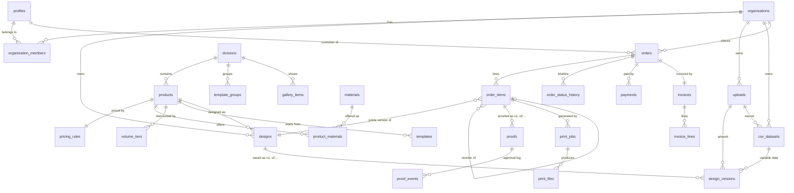

# Database schema

Supabase Postgres. Source of truth: `supabase/migrations/` (applied in order) plus `supabase/seed.sql` and `supabase/seed-templates.sql`. Generated TypeScript types: `src/lib/supabase/database.types.ts` (`npm run db:types`).

Conventions: money is **integer pence**, VAT-inclusive unless the column says `net`; physical sizes are **millimetres**; rates are **basis points** (10000 = 100 %); every table has row-level security (RLS) enabled.

## Entity relationships

## Tables

### Accounts
| Table | Purpose | Key columns |
|---|---|---|
| `profiles` | One row per auth user, created by the `on_auth_user_created` trigger. | `role` (`customer`/`admin`, never user-settable — D-032), `is_disabled`, `full_name`, `company_name`, `vat_number` |
| `organizations` | Owner of orders, designs and files; every user gets a personal one now, so company accounts need no migration (D-016). | `name`, `is_personal`, `vat_number` |
| `organization_members` | User ↔ organization. | `member_role` (`owner`/`member`) |

### Catalogue (PRD §04)
| Table | Purpose | Key columns |
|---|---|---|
| `divisions` | The six product families; a new division is a row (PRD §14). | `slug`, `name`, `tagline`, `is_active`, `sort_order` |
| `products` | One **parameter-driven** product per job type — never one row per size. | `parameters` (jsonb: size presets/ranges, orientations, quantity bounds), `bleed_mm`, `safe_margin_mm`, `dpi`, `product_type` (file-name code), `supports_designer/upload/variable_data` |
| `materials` | Stocks and finishes. | `price_factor_bps` |
| `product_materials` | Which materials a product offers; one default. | `is_default` |
| `pricing_rules` | Price formula per product (D-039). | `strategy` (`area`/`per_unit`/`per_character`), `setup_fee_minor`, `unit_base_minor`, `area_rate_minor_per_cm2`, `per_character_minor`, `min_unit_minor` |
| `volume_tiers` | Automatic volume discounts; `product_id null` = store defaults. | `min_quantity`, `discount_bps` |
| `tax_settings` | Single row: VAT label, rate, inclusive flag, currency, Xero tax type (D-006). | `rate_bps`, `prices_include_tax`, `currency`, `xero_tax_type` |
| `templates` | Size-independent starting layouts (D-049). | `scene` (jsonb, fractions of the print area, placeholder fitting rules), `is_default`, `is_active` |
| `template_groups` | Optional grouping of templates within a division. | `slug`, `name` |
| `gallery_items` | Gallery of work by product family. | `image_path`, `is_published` |

### Designs & files (PRD §06–07)
| Table | Purpose | Key columns |
|---|---|---|
| `designs` | A customer's job artwork; the editable draft lives here (D-048). | `configuration` (size, material, orientation, quantity), `source` (`designer`/`upload`), `draft_scene`, `current_version`, `upload_id`, `csv_dataset_id` |
| `design_versions` | Immutable saved versions v1, v2… that orders and proofs reference. | `version`, `scene` or `upload_id`, `csv_dataset_id` |
| `uploads` | Every uploaded file, recorded after the server re-checks its bytes (D-051). | `kind` (`artwork`/`logo`/`csv`), `bucket`, `path`, `mime_type`, `width_px`, `height_px`, `needs_preflight` |
| `csv_datasets` | Variable-data spreadsheets (D-053). | `columns`, `row_count`, `mapping` (placeholder → column) |

### Orders & payment (PRD §05, §09, §11)
| Table | Purpose | Key columns |
|---|---|---|
| `orders` | The job. Status `quote` is the basket (D-004); then `order → artwork → proof → production → completed` (or `cancelled`). | `order_number` (`MR-001001`), `status`, totals (`items_total_minor`, `discount_total_minor`, `delivery_minor`, `tax_minor`, `total_minor`), `delivery_method`, `shipping_address`, `files_ready`, `reorder_of`, `placed_at`, `completed_at`, `archived_at` |
| `order_items` | Lines, with product/price snapshots so history survives catalogue edits. | `design_id` + `design_version`, `configuration`, `quantity`, `unit_price_minor`, `discount_bps`, `discount_minor`, `setup_fee_minor`, `line_total_minor`, `tax_minor`, `csv_dataset_id`, `reorder_of_item_id` |
| `order_status_history` | Every status change with actor and note; drives the timeline. | `from_status`, `to_status`, `changed_by`, `note` |
| `payments` | Stripe Checkout sessions; `pending → succeeded` exactly once (D-058). | `provider_session_id` (unique), `provider_payment_intent`, `amount_minor`, `status` |

### Proofs & production (PRD §07–08)
| Table | Purpose | Key columns |
|---|---|---|
| `proofs` | Versioned proofs per line (v1, v2…), each tied to an immutable design version. | `version`, `status` (`pending`/`approved`/`changes_requested`/`superseded`), `design_version`, `preview_path` |
| `proof_events` | Approval log: who did what to which version, when, with comment. | `event` (`issued`/`approved`/`changes_requested`/`reorder_reused`), `actor_id`, `comment` |
| `print_jobs` | Queue for server-side print-file generation (D-064). | `status`, `attempts`, `progress_done/total` (CSV rows), `locked_at`, `error` |
| `print_files` | Generated production files, named `OrderID_ProductType_Date_Output`. | `kind` (`print_pdf`/`print_png`/`row_pdf`/`merged_pdf`/`original`), `path`, `row_index`, `size_bytes` |

### Accounting (PRD §05, D-018)
| Table | Purpose | Key columns |
|---|---|---|
| `invoices` | Xero-shaped invoice per paid order. | `invoice_number` (`MR-INV-001001`), `contact_name`, `issued_on`, `line_amount_type` (`Inclusive`), `net_minor`, `tax_minor`, `total_minor`, `exported_at` |
| `invoice_lines` | Quantity × UnitAmount = LineAmount exactly (setup fee and delivery are their own lines). | `description`, `quantity`, `unit_amount_minor`, `account_code`, `tax_type`, `line_amount_minor`, `tax_minor` |

## Access control (RLS)

| Who | Can read | Can write |
|---|---|---|
| Visitor (`anon`) | Active divisions, products, materials, pricing, tiers, tax settings, active templates, published gallery | Nothing |
| Customer | Their own profile; their organization's designs, versions, uploads, CSV datasets, orders, lines, history, payments, proofs, proof events, invoices | Own profile (not role/disabled/email — trigger-enforced); own designs, versions (insert only), uploads, CSV datasets |
| Admin | Everything (`private.is_admin()` policy on every table) | Everything |
| Server (secret key) | — | Orders, payments, proofs, print jobs/files, invoices — only after the service has authorised the actor (D-031) |

`print_jobs` and `print_files` have no customer policy at all: production files are admin-only (D-003). RLS helper functions live in the non-exposed `private` schema (D-037).

## Storage buckets

| Bucket | Public | Contents | Access |
|---|---|---|---|
| `uploads` | No | Customer artwork (PDF/SVG/AI/PNG ≤ 25 MB) | Owner organization folder (`<org>/<design>/…`) |
| `design-assets` | No | Logos placed in the designer | Owner organization folder |
| `csv-datasets` | No | Variable-data spreadsheets | Owner organization folder |
| `proofs` | No | Proof preview PNGs | Signed URLs issued by the server after an ownership check |
| `production` | No | Print-ready PDFs/PNGs | Admin only (signed download links) |
| `invoices` | No | Reserved; invoice PDFs are rendered on demand | — |
| `gallery` | Yes | Gallery photos | Public read, admin write |

## Functions, triggers and views

| Object | Purpose |
|---|---|
| `private.handle_new_user()` (trigger on `auth.users`) | Creates the profile (always `customer`), a personal organization and the membership. |
| `public.protect_profile_columns()` (trigger) | Blocks non-admins from changing `role`, `is_disabled` or `email`. |
| `public.set_updated_at()` (trigger) | Maintains `updated_at`. |
| `private.is_admin()`, `private.is_org_member(uuid)`, `private.can_access_order(uuid)` | RLS helpers (`SECURITY DEFINER`, not exposed through the API). |
| `public.admin_order_search` (view, `security_invoker`, service role only) | Flattened job database for the console search (D-067). |
| `public.admin_report(from, to)` (service role only) | Orders, revenue, VAT, units and product-family throughput for reports. |
| Sequences `order_number_seq`, `invoice_number_seq` | Human-readable order and invoice numbers (`MR-` prefix, D-045). |
